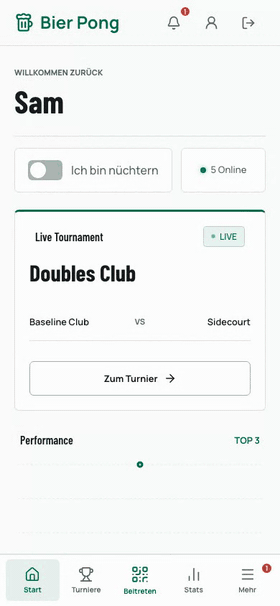
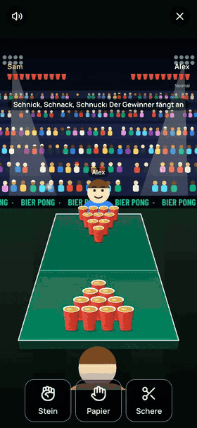
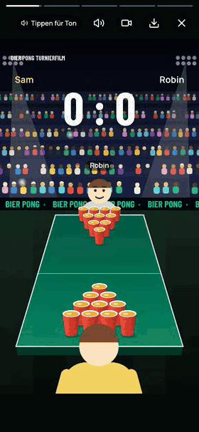
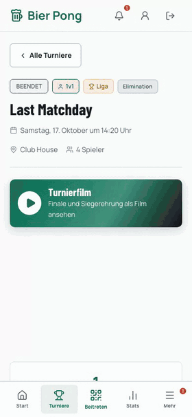
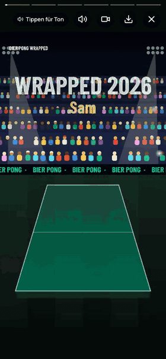

# Bier Pong Tournament Manager


A mobile-first web app for beer pong nights with friends: tournaments with live brackets, a swipe-to-throw mini game in a cheering stadium, a short film of every finished tournament, an animated year in review, seasons, stats and a messenger-style chat. Installable as a PWA, self-hosted on your own server.

<p align="center">
  
  &nbsp;
  
  &nbsp;
  
</p>

---

## Quick Setup

**Fresh server** — installs Node, nginx, SSL, PM2, and the app in one command:
```bash
curl -sL https://raw.githubusercontent.com/Zidans-Haare/beer-pong/main/setup.sh | bash
```
> [Inspect setup.sh](https://github.com/Zidans-Haare/beer-pong/blob/main/setup.sh) before running it. → [Full setup guide](docs/setup.md)

**Node already installed:**
```bash
npx github:Zidans-Haare/beer-pong
```

**Local development:**
```bash
git clone https://github.com/Zidans-Haare/beer-pong.git && cd beer-pong && npm run setup
```

---

## Features

<table>
<tr>
<td width="290" valign="top"></td>
<td valign="top">

### Tournaments
- **Formats** — knockout, round robin and group stage with playoffs; solo (1v1) and team (2v2); ranked league or just for fun
- **Live brackets** — tap to score, overtime, live ticker, time forecast per table
- **Host edit mode** — before the start the host changes time, place, mode, format, tables, league or fun, and who is playing; added players get a notification
- **Lobby** — players say yes, no or maybe; guests can join fun tournaments for 24 hours
- **Extras** — bring list with cost split and PayPal links, guest room with booking, QR code and short join code
- **TV view** — fullscreen standings and bracket for the big screen, optional WebRTC livestream from a phone

</td>
</tr>
<tr>
<td width="290" valign="top"></td>
<td valign="top">

### Mini game
- **Swipe to throw** — the ball flies a real arc over the table and drops into the cup from above; rim shots bounce off visibly
- **House rules** — bombs, islands, bounce shots (swatted away by the opponent), balls back, trick shots when the ball rolls back over the middle, rearranging from a bird's-eye view, naked mile
- **Against the computer** — easy, normal, hard and impossible
- **Duels** — challenge a friend asynchronously: you play your game, they answer when they have time; ties go to overtime, played in turns
- **Stadium** — the crowd jumps up for bombs, balls back and wins
- **Stats** — record per level, duels, head to head and a naked mile tracker (taken and dealt) on every profile

</td>
</tr>
<tr>
<td width="290" valign="top"><br/></td>
<td valign="top">

### Tournament film and podium
- **Film** — every finished tournament plays as a short scene: intro, the final replayed throw by throw, the winner, the podium and the key facts, with generated music and sound
- **Podium** — on a finished tournament the top three run in, cheer, walk back and jump onto their podium, every time you open it
- **Share** — export as a 1080×1920 video for stories or save single frames

</td>
</tr>
<tr>
<td width="290" valign="top"></td>
<td valign="top">

### Beer Pong Wrapped
- **Year in review** — an animated table scene per player: games, cups, record, main rival, wins and player type
- **Sound** — music and effects are generated in the browser (Web Audio), no audio files
- **Admin trigger** — pick a calendar year or a season, preview, publish for everyone; players get a notification and a banner
- **Archive** — past recaps stay available on the stats page

</td>
</tr>
<tr>
<td width="290" valign="top"></td>
<td valign="top">

### Figures and scenes
- **Your figure** — skin, hairstyle and colour, top and pattern, height, build and accessories (including a beer hat); it plays the mini game, stands on the podium, appears in Wrapped and the film, waves on the home page and dances on your profile
- **Five backgrounds** — stadium, classic, pub, beach and club; pick yours once and it is used in the mini game, Wrapped, the tournament film and behind your figure on the profile

</td>
</tr>
<tr>
<td width="290" valign="top"></td>
<td valign="top">

### Chat
- **Feels like a messenger** — fullscreen, follows the keyboard, keeps it open after sending, grouped bubbles with time and sent status, day separators, links
- **Several messages in a row** — sent in order, failed ones can be retried with a tap
- **History** — older messages load while scrolling up, who is online shows in the header

</td>
</tr>
</table>

### Seasons and stats
- **Seasons** — tournaments belong to a season by date; each season has its own accent colour that recolours the whole app
- **Ranking** — sorted by medals, win rate or cups per game, with form and current streak
- **Head to head** — record against every opponent, including nemesis and favourite opponent
- **Records** — longest win streak, biggest win, most cups in a tournament, longest game
- **Excel export** — rankings, tournaments, every game, tables, the head-to-head matrix and records in one workbook

### App
- **Rules page** — all house rules at `/rules`, including a section on how the mini game handles them
- **Drunk mode** — simplified navigation, a short intro scene and a deliberately wobbly interface (off with reduced motion)
- **Push notifications** — match calls, results, duels and tournament updates
- **Passkeys** — WebAuthn in addition to email and password
- **Admin** — approve players, override scores, manage tournaments, seasons, Wrapped and broadcasts
- **Maintenance mode** — via an nginx flag file, zero downtime
- **Multilingual** — English and German (`NEXT_PUBLIC_LOCALE` in `.env`)

---

## Tech Stack

| Layer | Technology |
|---|---|
| Framework | [Next.js 15](https://nextjs.org/) (App Router, Server Actions) |
| Language | TypeScript |
| Database | SQLite via [Prisma ORM](https://www.prisma.io/) + `better-sqlite3` |
| Auth | [NextAuth.js 5](https://next-auth.js.org/) (Credentials + Passkey) |
| UI | React 19, Framer Motion, Lucide Icons |
| Scenes & Audio | Canvas 2D (mini game, film, Wrapped, podium), Web Audio, MediaRecorder (video export) |
| Export | [ExcelJS](https://github.com/exceljs/exceljs) |
| Charts | [Recharts](https://recharts.org/) |
| Maps | Google Maps Platform |
| Email | [Resend](https://resend.com) |
| Error Tracking | [Sentry](https://sentry.io) |
| Streaming | WebRTC (built-in signaling) + optional [Cloudflare TURN](https://developers.cloudflare.com/calls/turn/) |
| Testing | [Vitest](https://vitest.dev/) (unit), [Playwright](https://playwright.dev/) (end-to-end, isolated database) |

---

## Documentation

| | |
|---|---|
| [Setup Guide](docs/setup.md) | DNS, APIs, Wizard walkthrough, system requirements |
| [Server Management](docs/server.md) | `bp-*` commands, updates, maintenance mode, doctor |
| [CI/CD](docs/cicd.md) | GitHub Actions, Webhook auto-deploy, required secrets |
| [Email](docs/email.md) | Resend setup, DNS records, triggered events |
| [Error Monitoring](docs/monitoring.md) | Sentry setup |
| [Redesign & Testing](docs/redesign.md) | Design notes, isolated end-to-end tests, local preview |
| [Test Server](docs/testserver-setup.md) | A separate test server with a copy of production |
| [Rollout](docs/rollout.md) | Checkliste für das Redesign-Update, Backup und Rückfallplan |

---

## Deployment Notes

- **Migrations** — run `node scripts/fix-migration-table.js` before `npx prisma migrate deploy`. Older databases store text timestamps in `_prisma_migrations`, which makes the current Prisma schema engine crash with "input contains invalid characters". The script converts them, keeps a backup next to the database and does nothing on a clean table. The GitHub Actions deploy already calls it.
- **Uploads** — profile pictures and guest room photos live in `UPLOAD_DIR` (default `user-uploads/`), outside the build, so updates do not remove them.
- **Passkeys** — set `WEBAUTHN_RP_ID` (domain without `https://`) and `WEBAUTHN_ORIGIN` (with `https://`) to your real domain; with `localhost` passkeys cannot be registered.
- **HTTPS** — Wrapped's share sheet, passkeys, push and the service worker need a secure context.

## Screenshots

The GIFs above are recorded from the isolated end-to-end environment (made-up players, no real data):

```bash
RECORD_README=1 E2E_MODE=isolated npx playwright test e2e/readme-media.spec.ts --project=chromium
bash scripts/readme-gifs.sh
```

---

## Star History

<a href="https://www.star-history.com/?repos=Zidans-Haare%2Fbeer-pong&type=date&legend=top-left">
 <picture>
   <source media="(prefers-color-scheme: dark)" srcset="https://api.star-history.com/image?repos=Zidans-Haare/beer-pong&type=date&theme=dark&legend=top-left" />
   <source media="(prefers-color-scheme: light)" srcset="https://api.star-history.com/image?repos=Zidans-Haare/beer-pong&type=date&legend=top-left" />
   
 </picture>
</a>

---

Made by Nick.
